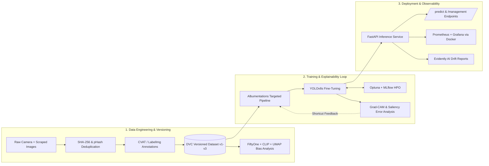

# Is It Always Fresh? — FreshSight: Fine-Grained Brand Object Detection & MLOps Pipeline

An end-to-end computer vision and MLOps system designed to solve fine-grained object detection: distinguishing **Tim Hortons paper cups** (`timmies`) from visually similar generic paper cups and mugs (`cup`) in cluttered, real-world environments.

> **Academic Integrity Notice:** This project was developed as part of a graduate Systems Design Engineering / Data Science course. In accordance with course policies, the raw dataset, model weights, and private remote storage credentials are excluded from this public repository.

---

## Problem Statement
Standard object detectors easily recognize generic "cups" but struggle with **intra-class fine-grained classification**—especially when brand identifiers (logos, colors, textures) are partially occluded, toppled, viewed from extreme angles, or surrounded by visual lookalikes (e.g., red solo cups, red-and-white packaging, cylindrical bottles).

---

## End-to-End Architecture

---

## Tech Stack Overview

| Pipeline Stage | Tools & Technologies | Key Implementation Details |
| :--- | :--- | :--- |
| **Data Versioning & Curation** | `DVC`, `CVAT`, `LabelImg`, `Python` | Managed 3 dataset versions (~2,800+ images) with SHA-256 & perceptual hashing (`pHash`) deduplication and HEIC/DNG format normalization. |
| **Exploratory Data Analysis** | `FiftyOne`, `CLIP`, `UMAP` | Visualized embedding clusters and bounding-box feature correlations to uncover hidden background, pose, and lighting biases. |
| **Model Training & Tuning** | `YOLOv8s`, `PyTorch`, `Optuna`, `MLflow` | Executed automated hyperparameter searches across batch sizes, learning rates, and warmup schedules on A100/H100 GPUs. |
| **Explainability & Error Analysis** | `Grad-CAM`, `Saliency Maps`, `Albumentations` | Diagnosed false positives and shortcut features, engineering class-conditional HSV jitter and geometric augmentations. |
| **Deployment & Observability** | `FastAPI`, `Docker`, `Prometheus`, `Grafana`, `Evidently AI` | Served a REST API with hot-swappable model weights, real-time container metrics, and automated drift reporting. |

---

## Iterative Engineering Workflow

### 1. Data-Centric Iteration & Statistical Audit (v1 → v3)
* **Combinatorial Data Collection:** Designed a stratified collection matrix covering background brightness, occlusion types (hand, vertical, horizontal), orientation (upright vs. toppled), camera distance, and viewing angles.
* **Quantitative Dataset Balance:** Maintained a balanced object-level distribution (**56% `timmies` vs. 43% `cup`**) with **16.2% mixed-class scenes (412 images)** containing both classes side-by-side to eliminate scene-context shortcuts. Feature correlation analysis confirmed zero linear separability from bounding-box geometry alone, forcing the model to learn visual brand cues.
* **Embedding Cluster Analysis (`FiftyOne` + `UMAP`):**
  * *v1 → v2:* Discovered that web-scraped mugs formed isolated clusters and that hand-occluded, toppled, and laptop-adjacent scenes skewed heavily toward `timmies`. Removed out-of-distribution scraped mugs and collected targeted hard negatives.
  * *v2 → v3:* Identified location bias (over-representation of a single room background) and portrait aspect-ratio skew (`0.75`). Added multi-cup scenes, varied non-brand cup designs, and applied stratified offline augmentations (`Albumentations`).

### 2. Explainability-Driven Shortcut Mitigation (`Grad-CAM` & `Saliency Maps`)
Before Experiment 3, we ran **Grad-CAM** and **Saliency Map** error analyses on validation false positives to diagnose shortcut features and engineer targeted fixes:

| Discovered Shortcut Feature | Root-Cause Evidence | Engineered Mitigation |
| :--- | :--- | :--- |
| **White-on-Red Color Blobs** | Heatmaps fired on generic red-and-white surfaces rather than cup structure. | Applied **class-conditional HSV jitter** (milder on `timmies`, stronger on `cup`) to break color reliance. |
| **Rectangular & Border Edges** | Activations triggered on laptop edges, shelves, and image letterbox borders. | Added **random padding and cropping** to decouple objects from fixed image borders. |
| **Repeated Surface Textures** | Saliency focused on local dot/gradient patterns instead of global geometry. | Introduced **light Gaussian blur, noise, and tight crops** to emphasize structural shape. |
| **Cylindrical / Tall Shapes** | Water bottles and lotion containers triggered generic `cup` false positives. | Tightened bounding boxes on small/distant cups and scoped hard-negative bottle mining. |

### 3. Hyperparameter & Hardware Scaling (Experiments 1 → 3)
* **Exp 1 (Baseline):** Fine-tuned `YOLOv8s` (`640px`, `AdamW`, batch `16`, `50` epochs, `lr0=0.001667`), achieving strong baseline recall (`97.26%`) but elevated validation box loss (`0.4377`).
* **Exp 2 (`Optuna` on A100 GPU):** Tuned across 12 trials (`batch=64`, `epochs=60`, `lr0=0.000451`, `lrf=0.00319`), boosting precision (`95.97%`) and exposing unannotated small background cups during error review.
* **Exp 3 (`Optuna` on H100 GPU + Label & Augmentation Fixes):** Scaled to an H100 GPU for 20 trials (`batch=64`, `epochs=70`, `lr0=0.000737`, `lrf=0.00589`). Disabled YOLO's `auto` learning rate—which diverged at larger batch sizes—and introduced a **5-epoch warmup** (`warmup_epochs=5.0`), driving validation **box loss down to `0.3892`** alongside major precision gains.

---

## Evaluation Results (Held-Out Test Set)

Evaluated on a strictly isolated 100-image multi-object test set across all three iterations:

| Experiment | Key Changes | Val Box Loss | Precision | Recall | F1 Score | mAP@50 | mAP@50-95 |
| :--- | :--- | :---: | :---: | :---: | :---: | :---: | :---: |
| **Exp 1** | Baseline `YOLOv8s` fine-tuning | 0.4377 | 94.78% | 97.26% | 0.9601 | 98.04% | 90.59% |
| **Exp 2** | `Optuna` hyperparameter search (A100) | 0.4391 | 95.97% | 97.05% | 0.9651 | 98.23% | 91.72% |
| **Exp 3** | Label fixes + `Grad-CAM` augmentations + H100 `Optuna` | **0.3892** | **99.27%** | **98.49%** | **0.9888** | **99.25%** | **93.73%** |

---

## Visual Diagnostics & Observability

| Embedding Space & Bias Discovery (`FiftyOne` + `UMAP`) | Model Explainability (`Grad-CAM` Heatmaps) |
| :---: | :---: |
|  |  |
| *CLIP + UMAP projection used to identify pose, background, and class imbalances across v1–v3.* | *Class-activation heatmaps confirming brand-logo localization and guiding shortcut mitigation.* |

| Held-Out Test Performance (Experiment 3) | Production Telemetry (`Grafana` / `Evidently AI`) |
| :---: | :---: |
|  |  |
| *Final test-set evaluation achieving 99.27% precision, 98.49% recall, and 93.73% mAP@50-95.* | *Real-time API latency, request volume, and automated drift tracking.* |

---

## Inference API & Monitoring Architecture

The production inference service is built with **FastAPI** and instrumented for full-stack observability:

### Core API Endpoints
* `POST /predict` — Accepts dynamic image uploads and returns bounding box coordinates, confidence scores, and class predictions (`timmies` vs. `cup`).
* `GET /management/models` — Lists available trained model versions.
* `GET /management/models/{model}/describe` — Returns architecture metadata and validation metrics for a specific model.
* `GET /management/models/{model}/set-default` — Dynamically hot-swaps the active inference model without server downtime.
* `GET /metrics` & `GET /health-status` — Exposes real-time inference latency, request volume, and service health.

### Observability Stack
* **Prometheus & Grafana (Docker Compose):** Scrapes API telemetry via a metrics adapter to visualize request throughput, error rates, and p50/p95/p99 inference latency in real time.
* **Evidently AI:** Evaluates live prediction logs against reference baselines to generate HTML data-drift and model-performance reports.

---

## Exploratory R&D & Future Work
* **3D Synthetic Data (`Blender`):** Modeled dimensionally accurate Medium Tim Hortons cups (with logo and maple leaf branding) alongside glossy red party cups in Blender. Future iterations will scale photorealistic synthetic generation using randomized HDRI lighting and backgrounds.
* **Generative Data Prototyping (`GAN`):** Explored training a Generative Adversarial Network to synthesize cup variations, documenting compute/convergence trade-offs before standardizing on targeted `Albumentations` pipelines.
* **Hard-Negative Mining:** Incorporate explicit negative training samples of red-and-white non-brand packaging, water bottles, and rectangular office clutter to further eliminate edge-case false positives.

