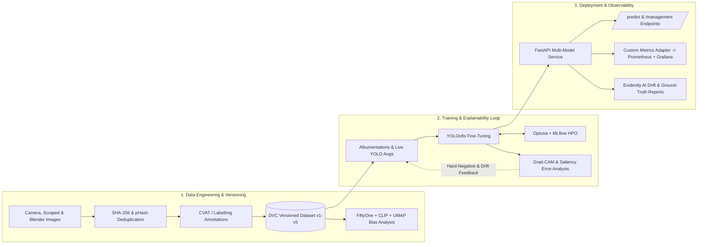
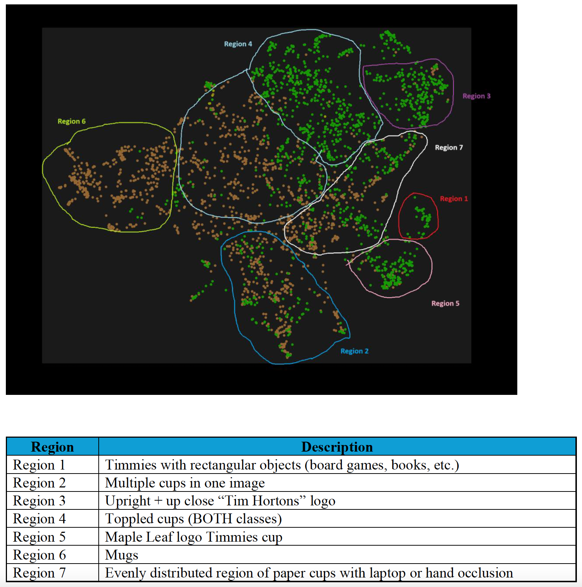
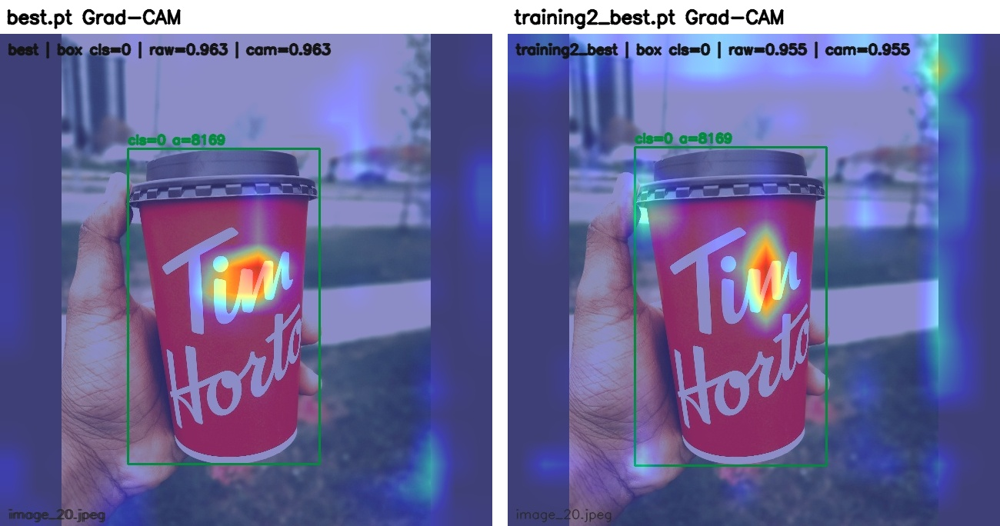
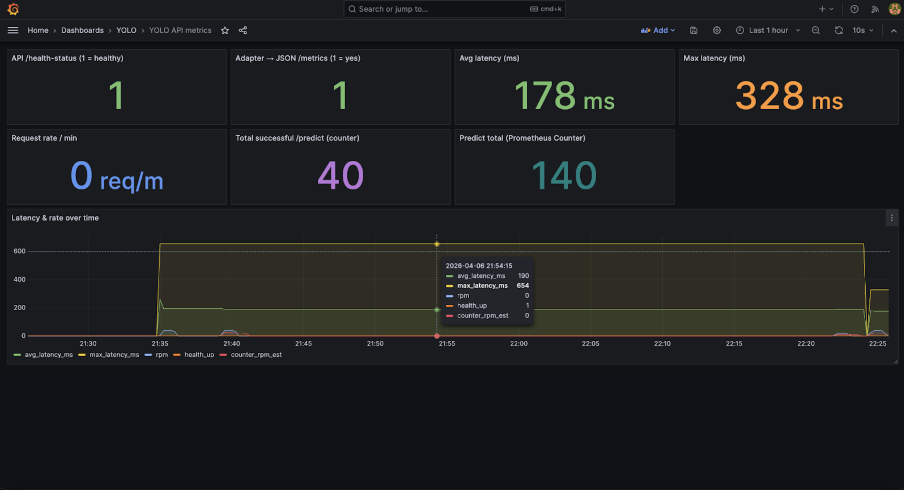
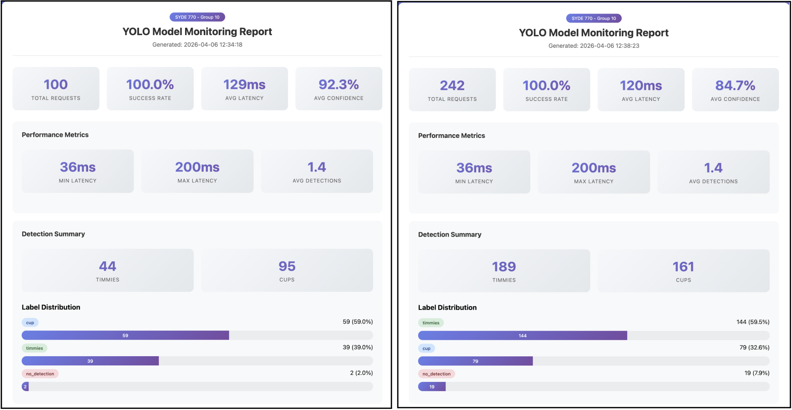
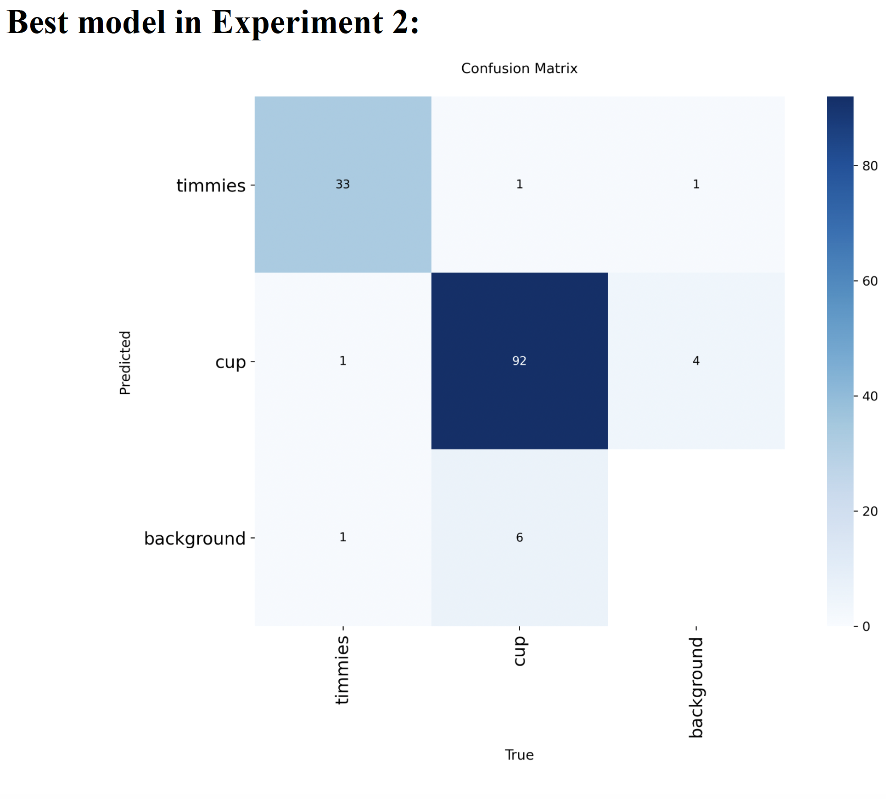
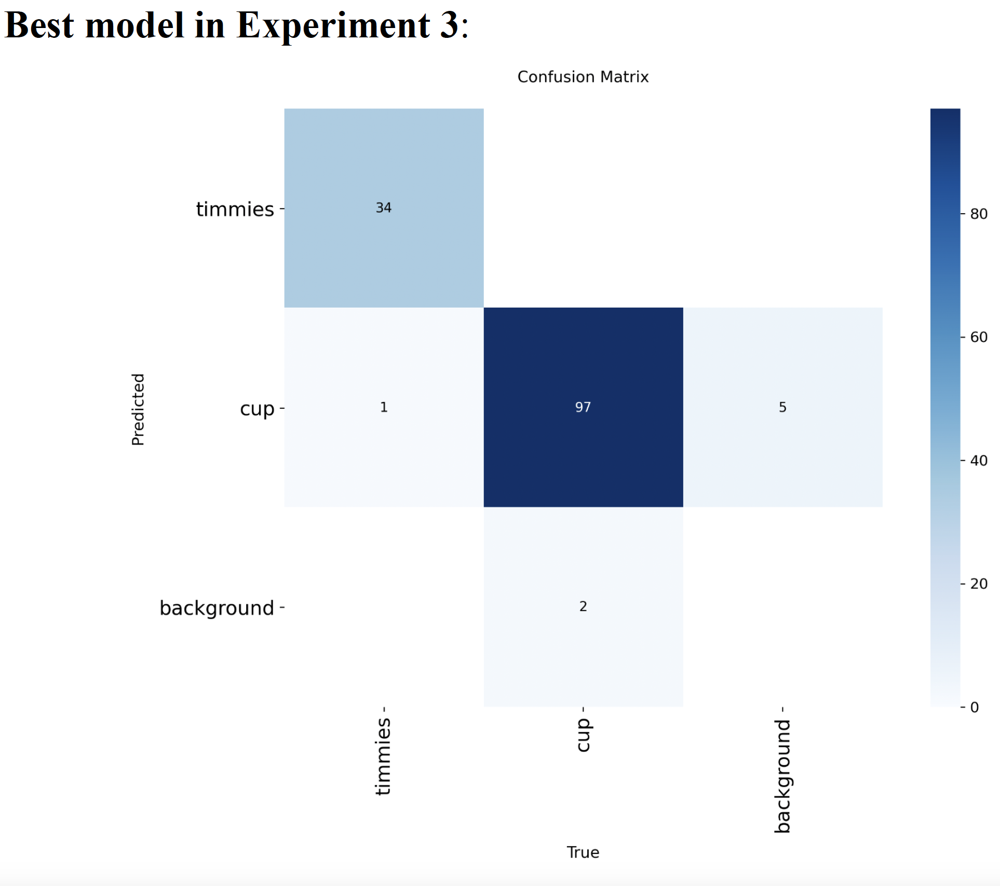

# Is It Always Fresh? — FreshSight: Fine-Grained Brand Object Detection & MLOps Pipeline

An end-to-end computer vision and MLOps system designed to solve fine-grained object detection: distinguishing **Tim Hortons cups** (`timmies`) from visually similar generic cups and mugs (`cup`) in cluttered, real-world environments.

> **Academic Integrity Notice:** This project was developed as part of a graduate Systems Design Engineering / Data Science course. In accordance with course policies, the raw dataset, model weights, and private remote storage credentials are excluded from this public repository.

---

## Problem Statement
Standard object detectors easily recognize generic "cups" but struggle with **intra-class fine-grained classification**—especially when brand identifiers (logos, colors, textures) are partially occluded, stacked in towers, camouflaged against matching backgrounds, or surrounded by visual lookalikes (e.g., red solo cups, red-and-white packaging, cylindrical bottles).

---

## End-to-End Architecture

---

## Tech Stack Overview

| Pipeline Stage | Tools & Technologies | Key Implementation Details |
| :--- | :--- | :--- |
| **Data Versioning & Curation** | `DVC`, `CVAT`, `LabelImg`, `Blender`, `Python` | Managed 5 dataset iterations (~3,400+ images) with SHA-256 & perceptual hashing (`pHash`) deduplication, HEIC/DNG normalization, and synthetic Blender renders. |
| **Exploratory Data Analysis** | `FiftyOne`, `CLIP`, `UMAP` | Visualized embedding clusters and bounding-box feature correlations to uncover hidden background, pose, and lighting biases. |
| **Model Training & Tuning** | `YOLOv8s`, `PyTorch`, `Optuna`, `MLflow` | Executed automated hyperparameter searches across batch sizes, learning rates, patience, and warmup schedules on A100/H100 GPUs. |
| **Explainability & Error Analysis** | `Grad-CAM`, `Saliency Maps`, `Albumentations` | Diagnosed false positives and shortcut features, engineering class-conditional HSV jitter and geometric augmentations. |
| **Deployment & Observability** | `FastAPI`, `Docker`, `Prometheus`, `Grafana`, `Evidently AI` | Served a REST API with hot-swappable model weights, a custom OpenMetrics adapter, live Grafana telemetry, and statistical drift reporting. |

---

## Iterative Engineering Workflow

### 1. Data-Centric Iteration & Statistical Audit (v1 → v3)
* **Combinatorial Data Collection:** Designed a stratified collection matrix covering background brightness, occlusion types (hand, vertical, horizontal), orientation (upright vs. toppled), camera distance, and viewing angles.
* **Quantitative Dataset Balance:** Maintained a balanced object-level distribution (**56% `timmies` vs. 43% `cup`**) with **16.2% mixed-class scenes (412 images)** containing both classes side-by-side. Feature correlation analysis confirmed zero linear separability from bounding-box geometry alone, forcing the model to learn visual brand cues.
* **Embedding Cluster Analysis (`FiftyOne` + `UMAP`):**
  * *v1 → v2:* Discovered that web-scraped mugs formed isolated clusters and that hand-occluded, toppled, and laptop-adjacent scenes skewed heavily toward `timmies`. Removed out-of-distribution scraped mugs and collected targeted hard negatives.
  * *v2 → v3:* Identified location bias and portrait aspect-ratio skew (`0.75`). Added multi-cup scenes, varied non-brand cup designs, and applied stratified offline augmentations (`Albumentations`).

### 2. Explainability-Driven Shortcut Mitigation (`Grad-CAM` & `Saliency Maps`)
We ran **Grad-CAM** and **Saliency Map** error analyses on validation false positives to diagnose shortcut features and engineer targeted fixes:

| Discovered Shortcut Feature | Root-Cause Evidence | Engineered Mitigation |
| :--- | :--- | :--- |
| **White-on-Red Color Blobs** | Heatmaps fired on generic red-and-white surfaces rather than cup structure. | Applied **class-conditional HSV jitter** (milder on `timmies`, stronger on `cup`) to break color reliance. |
| **Rectangular & Border Edges** | Activations triggered on laptop edges, shelves, and image letterbox borders. | Added **random padding and cropping** to decouple objects from fixed image borders. |
| **Repeated Surface Textures** | Saliency focused on local dot/gradient patterns instead of global geometry. | Introduced **light Gaussian blur, noise, and tight crops** to emphasize structural shape. |
| **Cylindrical / Tall Shapes** | Water bottles and lotion containers triggered generic `cup` false positives. | Tightened bounding boxes on small/distant cups and added hard-negative bottle/container samples. |

### 3. Production Drift Discovery & Iterative Retraining (v4 → v5)
* **Drift-Triggered Retraining (`v4`):** Production drift testing on non-brand red cups, stacked cups, and Tim Hortons iced coffee cups caused model confidence variance to double (`0.14 → 0.26`) and mean confidence to drop (`0.92 → 0.85`). We curated **538 new hard-negative and iced-cup images** (`269` base + `269` augmented), dramatically boosting out-of-distribution performance (`A4_best_model`).
* **Edge-Case Hardening & Ablation Insights (`v5`):** Grad-CAM analysis on hard edge cases revealed four remaining failure modes: *stacked cups detected as a single object*, *cup towers*, *3D/CGI-rendered cups*, and *cups camouflaged against same-color backgrounds*. We added targeted real and **Blender-rendered synthetic cups**, increased Optuna early-stopping patience (`5 → 15`), and introduced live per-epoch YOLO augmentations (`A5_best_model`).
* **Data-Driven Model Selection:** Evaluating both models on an expanded hard benchmark showed that `A5_best_model` achieved higher recall (`97.83%`), while `A4_best_model` maintained superior overall precision (`99.24%`) and `mAP@50-95` (`95.37%`) because stacking too many aggressive augmentations simultaneously increased background false positives. Consequently, we deployed **`A4_best_model` as the default production model** while keeping `A5_best_model` hot-swappable via the management API.

---

## Evaluation Results

### Phase 1: Initial Controlled Test Set (100 Multi-Object Images)

| Experiment | Key Changes | Val Box Loss | Precision | Recall | F1 Score | mAP@50 | mAP@50-95 |
| :--- | :--- | :---: | :---: | :---: | :---: | :---: | :---: |
| **Exp 1** | Baseline `YOLOv8s` (`AdamW`, batch `16`) | 0.4377 | 94.78% | 97.26% | 0.9601 | 98.04% | 90.59% |
| **Exp 2** | `Optuna` HPO on A100 (`batch=64`, `lr0=0.00045`) | 0.4391 | 95.97% | 97.05% | 0.9651 | 98.23% | 91.72% |
| **Exp 3 (`A3`)** | Label fixes + `Grad-CAM` augs + H100 `Optuna` (`warmup=5.0`) | **0.3892** | **99.27%** | **98.49%** | **0.9888** | **99.25%** | **93.73%** |

### Phase 2: Hard Out-of-Distribution Benchmark (Stacked Cups, Red Non-Tims, CGI & Camouflage)

| Model Version | Dataset & Training Updates | Precision | Recall | mAP@50 | mAP@50-95 | Production Status |
| :--- | :--- | :---: | :---: | :---: | :---: | :--- |
| **`A3_best_model`** | Baseline model prior to drift retraining | 89.33% | 85.92% | 91.88% | 82.97% | Archived |
| **`A4_best_model`** | +538 hard negatives (red non-Tims, stacked, iced cups) | **99.24%** | 97.20% | 98.92% | **95.37%** | **Default Production Model** |
| **`A5_best_model`** | +Cup towers, Blender CGI cups, live per-epoch YOLO augs | 97.72% | **97.83%** | **98.98%** | 92.89% | Secondary Hot-Swap Model |

---

## 🖼️ Visual Diagnostics & Observability

| Embedding Space & Bias Discovery (`FiftyOne` + `UMAP`) | Model Explainability (`Grad-CAM` Heatmaps) |
| :---: | :---: |
|  |  |
| *CLIP + UMAP projection used to identify pose, background, and class imbalances across dataset versions.* | *Class-activation heatmaps confirming brand-logo localization. [📂 **Browse all Grad-CAM heatmaps →**](gradcam/)* |

| Live Operational Telemetry (`Prometheus` + `Grafana`) | Statistical Drift & Ground-Truth Report (`Evidently AI`) |
| :---: | :---: |
|  |  |
| *Real-time API health, RPM throughput, and p50/max latency (~114ms median) via custom OpenMetrics adapter.* | *K-S & Z-test drift detection flagging confidence shifts (`0.92 -> 0.85`) and tracking ground-truth accuracy.* |

---

### Confusion Matrix Progression (Experiments 1 → 3)

| Experiment 1 (Baseline) | Experiment 2 (`Optuna` HPO) | Experiment 3 (`Grad-CAM` Augs + Label Fixes) |
| :---: | :---: | :---: |
|  |  |  |
| *Baseline `YOLOv8s` showing higher background false positives (`45` total) from unlabeled small cups.* | *`Optuna` tuning improves precision slightly, while exposing background misclassifications.* | *Targeted augmentations and small-cup labeling cut background false positives down to `16`.* |

---

## Inference API & Two-Layer Monitoring Architecture

The production inference service is built with **FastAPI** and instrumented with both **real-time operational telemetry** and **batch statistical drift detection**:

### Core API Endpoints
* `POST /predict` — Accepts dynamic image uploads and returns bounding box coordinates, confidence scores, and class predictions (`timmies` vs. `cup`).
* `GET /management/models` — Lists available trained model versions (`A4_best_model`, `A5_best_model`).
* `GET /management/models/{model}/describe` — Returns architecture metadata and validation metrics for a specific model.